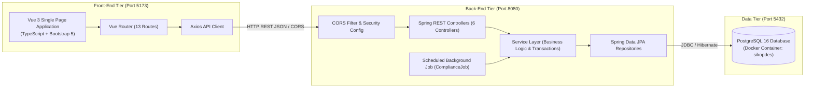

# SIKopDes - Modul KD1: Keanggotaan dan Simpanan

Aplikasi **SIKopDes (Sistem Informasi Koperasi Desa Merah Biru)** - Modul **KD1: Keanggotaan dan Simpanan** adalah platform full-stack terintegrasi yang dirancang untuk mengelola siklus operasional keanggotaan warga desa dan transaksi simpanan secara akuntabel, transparan, dan otomatis.

- **Nama Mahasiswa**: Raihan Maulana Heriandry
- **NPM**: 2406351024
- **Kelas**: APAP-C
- **Tech Stack**:
  - **Back-End**: Java 25, Spring Boot 4.x, Spring Data JPA, Hibernate, PostgreSQL 16
  - **Front-End**: Vue 3 (Composition API / `<script setup>`), Vite, TypeScript, Bootstrap 5, Chart.js, Axios
  - **DevOps / Database**: Docker & Docker Compose

---

## 🏛️ Arsitektur Solusi Sistem

Sistem mengadopsi arsitektur terpisah (*Decoupled Architecture*) antara Front-End SPA (*Single Page Application*) dan Back-End RESTful API dengan komunikasi berbasis JSON dan proteksi CORS terpusat.



---

## 📂 Struktur Repositori

```
sikopdes-2406351024/
├── docker-compose.yaml             # Orkestrasi container PostgreSQL 16
├── TI_SIKD1_2406351024.zip         # Berkas submisi SCeLE berisi executable SIKD12406351024.jar
├── README.md                       # Dokumentasi utama proyek tingkat root
│
├── sikopdes-2406351024-be/         # [BACK-END] Spring Boot 4 & Java 25
│   ├── gradle/wrapper/             # Binary Gradle wrapper & konfigurasi
│   ├── src/
│   │   ├── main/
│   │   │   ├── java/apap/ti/_6/sikopdes_2406351024_be/
│   │   │   │   ├── config/         # Konfigurasi CORS (CorsConfig.java)
│   │   │   │   ├── controller/     # 6 REST API Controllers
│   │   │   │   ├── dto/            # Request payloads & Response objects
│   │   │   │   ├── exception/      # Centralized GlobalExceptionHandler & custom exceptions
│   │   │   │   ├── model/          # JPA Entities (Anggota, Simpanan, Riwayat, Pemeriksaan)
│   │   │   │   ├── repository/     # Spring Data JPA Repositories
│   │   │   │   ├── scheduler/      # Background evaluation job (@Scheduled)
│   │   │   │   ├── seeder/         # Inisialisasi data realistis berbasis DataFaker
│   │   │   │   ├── service/        # Interface & Service Layer Implementation
│   │   │   │   └── Sikopdes2406351024BeApplication.java
│   │   │   └── resources/
│   │   │       └── application.yaml # Konfigurasi Spring, import .env, datasource
│   │   └── test/                   # Integration & unit test suites
│   ├── .env                        # Environment variables lokal (DB credentials)
│   ├── .gitignore                  # Mengabaikan .env, build/, .gradle, IDE files
│   ├── build.gradle                # Definisi dependensi & build task bootJar
│   ├── gradlew / gradlew.bat       # Wrapper script Gradle
│   └── README.md                   # Dokumentasi detail Back-End & Endpoints
│
└── sikopdes-2406351024-fe/         # [FRONT-END] Vue 3, Vite, TypeScript
    ├── public/                     # Aset publik statis
    ├── src/
    │   ├── __tests__/              # Unit test komponen dengan Vitest
    │   ├── components/             # Reusable UI component (Navbar.vue)
    │   ├── router/                 # Vue Router (13 rute halaman)
    │   ├── services/               # Axios HTTP Client instance
    │   ├── utils/                  # Formatter tanggal & mata uang Rupiah
    │   ├── views/                  # 13 Halaman tampilan terkelompok modular:
    │   │   ├── anggota/            # List, Detail, Create, Update Anggota
    │   │   ├── riwayat/            # List & Detail Riwayat Status
    │   │   ├── simpanan/           # List, Detail, Pokok, Wajib/Sukarela, Kepatuhan
    │   │   ├── statistik/          # Chart.js Visualisasi Tren & Distribusi
    │   │   └── HomeView.vue        # Dashboard Beranda & ringkasan operasional
    │   ├── App.vue                 # Root Single Page Component
    │   └── main.ts                 # Inisialisasi aplikasi Vue
    ├── eslint.config.ts            # Konfigurasi ESLint & Oxlint
    ├── package.json                # Dependensi npm & skrip dev/build/test
    ├── tsconfig.json               # Konfigurasi TypeScript
    ├── vite.config.ts              # Konfigurasi bundler Vite
    └── README.md                   # Dokumentasi detail Front-End & Fitur UI
```

---

## ⚙️ Environment Variables & Konfigurasi

### 1. Back-End Environment Variables (`.env`)
Aplikasi Spring Boot mendukung pembacaan berkas `.env` melalui deklarasi pada `application.yaml`:
```yaml
spring:
  config:
    import: optional:file:.env[.properties]
  datasource:
    url: ${DB_URL:jdbc:postgresql://localhost:5432/sikopdes}
    username: ${DB_USERNAME:sikopdes}
    password: ${DB_PASSWORD:sikopdes}
```
Berkas `.env` diletakkan di direktori root backend (`sikopdes-2406351024-be/.env`):
```properties
DB_URL=jdbc:postgresql://localhost:5432/sikopdes
DB_USERNAME=sikopdes
DB_PASSWORD=sikopdes
```

### 2. Penanganan CORS (Cross-Origin Resource Sharing)
Aplikasi Spring Boot telah mengizinkan permintaan dari origin frontend (`http://localhost:5173`, `http://127.0.0.1:5173`, `http://localhost:3000`) dengan method `GET, POST, PUT, DELETE, OPTIONS, PATCH`, mengizinkan semua header HTTP, dan mendukung credentials (`allowCredentials: true`) melalui class `CorsConfig`.

---

## 🚀 Panduan Menjalankan Aplikasi (Quickstart)

### 1. Jalankan Database PostgreSQL (Docker)
Pastikan Docker Desktop aktif di perangkat Anda, lalu jalankan perintah berikut dari direktori root proyek:
```bash
docker compose up -d
```
Container `sikopdes-postgres` akan menyala di porta `5432` dengan database `sikopdes` (user: `sikopdes`, password: `sikopdes`).

### 2. Jalankan Back-End (Spring Boot)
Buka terminal baru, masuk ke direktori backend, dan jalankan:
```bash
cd sikopdes-2406351024-be
./gradlew bootRun
```
*Catatan untuk Windows:* Gunakan `.\gradlew.bat bootRun`.
Aplikasi back-end akan berjalan di `http://localhost:8080`. Seeder otomatis (`DataSeeder`) akan mengecek database; apabila masih kosong, seeder akan mengisi data awal secara realistis.

### 3. Jalankan Front-End (Vue 3 / Vite)
Buka terminal baru, masuk ke direktori frontend, instal dependensi lalu jalankan dev server:
```bash
cd sikopdes-2406351024-fe
npm install
npm run dev
```
Aplikasi front-end siap diakses melalui peramban web pada:
```
http://localhost:5173
```

---

## 📋 Cakupan Fungsionalitas Modul KD1

| No | Modul / Fitur | Rute Front-End | Endpoint Back-End | Deskripsi Singkat |
|:---|:---|:---|:---|:---|
| 1 | **Beranda & Dashboard** | `/` | `GET /api/dashboard/stats` | Ringkasan metrik status anggota & total setoran bulan berjalan. |
| 2 | **Daftar Anggota** | `/anggota` | `GET /api/anggota` | Menampilkan seluruh anggota, live search & filter status. |
| 3 | **Detail Anggota** | `/anggota/:id` | `GET /api/anggota/{id}` | Informasi biodata lengkap, saldo simpanan, dan riwayat status. |
| 4 | **Pendaftaran Anggota** | `/anggota/create` | `POST /api/anggota` | Input data calon anggota baru (status awal `MENUNGGU_VERIFIKASI`). |
| 5 | **Ubah Data Anggota** | `/anggota/:id/update` | `PUT /api/anggota/{id}` | Pembaruan profil anggota tanpa mengubah NIK & nomor anggota. |
| 6 | **Verifikasi / Penolakan** | `/anggota/:id` | `POST /api/anggota/{id}/verifikasi` | Verifikasi ke `MENUNGGU_SETORAN_POKOK` atau tolak ke `DITOLAK`. |
| 7 | **Keluar (Soft Delete)** | `/anggota/:id` | `DELETE /api/anggota/{id}/keluar` | Pengeluaran anggota dari koperasi dengan input alasan wajib. |
| 8 | **Pembekuan / Aktivasi** | `/anggota/:id` | `PUT /api/anggota/{id}/status` | Bekukan anggota (`DIBEKUKAN`) atau aktifkan kembali (`AKTIF`). |
| 9 | **Daftar Simpanan** | `/simpanan` | `GET /api/simpanan` | Mutasi transaksi simpanan dengan filter jenis, periode, dan nominal. |
| 10 | **Detail Simpanan** | `/simpanan/:id` | `GET /api/simpanan/{id}` | Rincian transaksi setoran simpanan (read-only). |
| 11 | **Setor Simpanan Pokok** | `/simpanan/pokok/create` | `POST /api/simpanan/pokok` | Setoran pokok min. 100k, aktivasi anggota otomatis menjadi `AKTIF`. |
| 12 | **Setor Wajib & Sukarela**| `/simpanan/create` | `POST /api/simpanan` | Setoran wajib bulanan (format YYYY-MM) & setoran sukarela. |
| 13 | **Kepatuhan Simpanan** | `/simpanan/kepatuhan` | `GET /api/kepatuhan`<br>`POST /api/kepatuhan/trigger` | Evaluasi 3 periode selesai & histori eksekusi job otomatis. |
| 14 | **Daftar Riwayat Status** | `/riwayat-status` | `GET /api/riwayat-status` | Audit trail perubahan status terurut descending tanggal. |
| 15 | **Detail Riwayat Status** | `/riwayat-status/:id` | `GET /api/riwayat-status/{id}` | Rincian histori status dan metadata eksekusi sistem. |
| 16 | **Statistika & Grafik** | `/statistik` | `GET /api/statistik` | Visualisasi interaktif grafik Chart.js (tren 12 bulan & sebaran status). |

---

## 🧪 Pengujian & Kualitas Kode

### Back-End:
```bash
cd sikopdes-2406351024-be

# Menjalankan test suite
./gradlew test

# Menghasilkan executable jar file (build/libs/SIKD12406351024.jar)
./gradlew bootJar
```

### Front-End:
```bash
cd sikopdes-2406351024-fe

# Pemeriksaan linter & styling
npm run lint

# Menjalankan pengujian komponen dengan Vitest
npx vitest run

# Build bundle produksi
npm run build
```

---

## 📖 Dokumentasi Spesifik Komponen
Untuk panduan arsitektural dan spesifikasi teknis mendalam pada masing-masing tier, silakan merujuk ke:
- 📄 [README Back-End](sikopdes-2406351024-be/README.md)
- 📄 [README Front-End](sikopdes-2406351024-fe/README.md)
