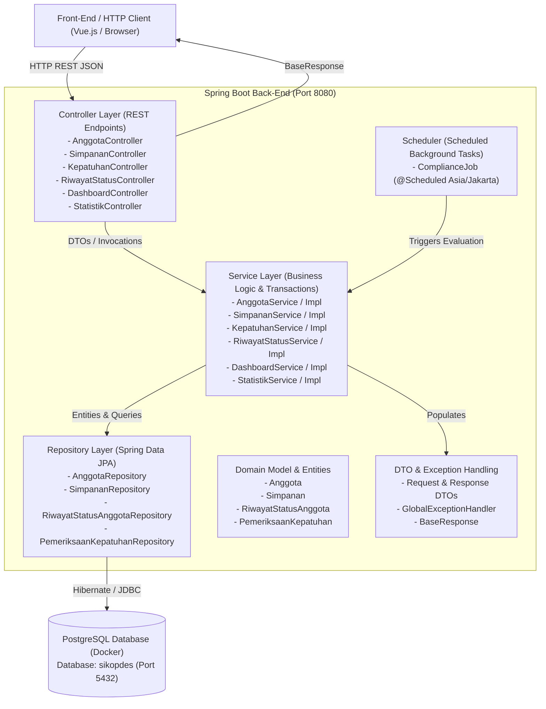
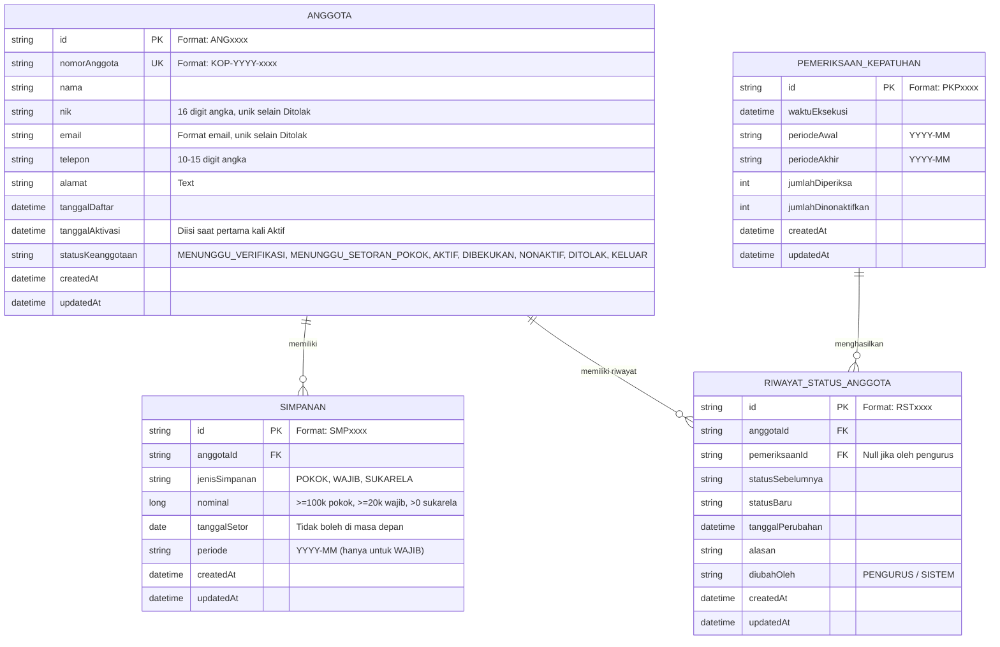

# SIKopDes - Modul KD1: Keanggotaan dan Simpanan (Back-End)

Repositori ini merupakan implementasi back-end untuk **SIKopDes (Sistem Informasi Koperasi Desa Merah Biru)** - Modul **KD1: Keanggotaan dan Simpanan**, yang dikembangkan menggunakan **Spring Boot 4 / Java 25** dan basis data **PostgreSQL**.

- **Nama**: Raihan Maulana Heriandry
- **NPM**: 2406351024
- **Mata Kuliah**: Arsitektur Perangkat Lunak Terintegrasi (APAP) - Gasal 2026/2027

---

## 🏗️ 1. Arsitektur & Penerapan Konsep Layering

Aplikasi dirancang dengan pendekatan arsitektur berorientasi lapisan (*Layered Architecture*) yang memisahkan tanggung jawab secara tegas (*Separation of Concerns*) dan menerapkan DI.



### Penjelasan Lapisan Arsitektur:
1. **Controller Layer**: Bertanggung jawab menerima request HTTP, melakukan validasi payload DTO awal, memanggil service terkait, dan membungkus hasil dalam format standar `BaseResponse<T>`.
2. **Service Layer**: Mengenkapsulasi seluruh aturan bisnis, validasi logika domain, state machine status keanggotaan, pengecekan kepatuhan kalender, dan transaksi atomik database menggunakan `@Transactional`.
3. **Repository Layer**: Abstraksi akses data menggunakan Spring Data JPA dengan query kustom JPQL/Criteria untuk pencarian dinamis, pagination, dan aggregasi numerik/statistik.
4. **Model/Entity Layer**: Pemetaan objek relasional database menggunakan JPA/Hibernate (`Anggota`, `Simpanan`, `RiwayatStatusAnggota`, `PemeriksaanKepatuhan`) beserta constraint keunikan dan integritas referensial.
5. **Scheduler Component**: Eksekusi periodik kepatuhan simpanan wajib otomatis berbasis cron `@Scheduled(zone = "Asia/Jakarta")` yang bersifat idempoten.

---

## 📂 2. Struktur Repositori

```
sikopdes-2406351024-be/
├── gradle/
│   └── wrapper/
│       ├── gradle-wrapper.jar
│       └── gradle-wrapper.properties
├── src/
│   ├── main/
│   │   ├── java/apap/ti/_6/sikopdes_2406351024_be/
│   │   │   ├── config/
│   │   │   │   └── CorsConfig.java               # Konfigurasi CORS & integrasi ke Front-End
│   │   │   ├── controller/
│   │   │   │   ├── AnggotaController.java        # REST Controller manajemen anggota
│   │   │   │   ├── DashboardController.java      # REST Controller metrik beranda
│   │   │   │   ├── KepatuhanController.java      # REST Controller kepatuhan simpanan wajib
│   │   │   │   ├── RiwayatStatusController.java  # REST Controller audit trail riwayat status
│   │   │   │   ├── SimpananController.java       # REST Controller transaksi simpanan
│   │   │   │   └── StatistikController.java      # REST Controller agregasi statistika
│   │   │   ├── dto/
│   │   │   │   ├── request/                      # DTO payload permintaan (Request Body)
│   │   │   │   └── response/                     # DTO respons & BaseResponse<T>
│   │   │   ├── exception/
│   │   │   │   ├── BadRequestException.java
│   │   │   │   ├── GlobalExceptionHandler.java   # Penanganan error global terpusat
│   │   │   │   ├── InvalidActionException.java
│   │   │   │   └── ResourceNotFoundException.java
│   │   │   ├── model/                            # Entitas domain JPA / Hibernate
│   │   │   │   ├── Anggota.java
│   │   │   │   ├── PemeriksaanKepatuhan.java
│   │   │   │   ├── RiwayatStatusAnggota.java
│   │   │   │   └── Simpanan.java
│   │   │   ├── repository/                       # Interface Spring Data JPA Repository
│   │   │   │   ├── AnggotaRepository.java
│   │   │   │   ├── PemeriksaanKepatuhanRepository.java
│   │   │   │   ├── RiwayatStatusAnggotaRepository.java
│   │   │   │   └── SimpananRepository.java
│   │   │   ├── scheduler/
│   │   │   │   └── ComplianceJob.java            # Job otomatis evaluasi kepatuhan (@Scheduled)
│   │   │   ├── seeder/
│   │   │   │   └── DataSeeder.java               # Inisialisasi data realistis (DataFaker)
│   │   │   ├── service/                          # Interface Service Layer
│   │   │   │   ├── impl/                         # Implementasi logika bisnis & transaksi
│   │   │   │   ├── AnggotaService.java
│   │   │   │   ├── DashboardService.java
│   │   │   │   ├── KepatuhanService.java
│   │   │   │   ├── RiwayatStatusService.java
│   │   │   │   ├── SimpananService.java
│   │   │   │   └── StatistikService.java
│   │   │   └── Sikopdes2406351024BeApplication.java # Entry point aplikasi Spring Boot
│   │   └── resources/
│   │       ├── application.yaml                  # Konfigurasi aplikasi, env vars, dan datasource
│   │       ├── static/
│   │       └── templates/
│   └── test/
│       └── java/apap/ti/_6/sikopdes_2406351024_be/
│           └── Sikopdes2406351024BeApplicationTests.java
├── .env                                          # Environment variables lokal (DB_URL, dll.)
├── .gitattributes
├── .gitignore                                    # Mengabaikan build/, .gradle, .env, dsb.
├── build.gradle                                  # Definisi dependensi & task build Gradle
├── gradlew                                       # Script wrapper Gradle untuk Linux/macOS
├── gradlew.bat                                   # Script wrapper Gradle untuk Windows
└── settings.gradle
```

---

## 🗄️ 3. Diagram Relasi Entitas (ERD)



---

## ⚙️ 4. Prasyarat & Instalasi

### Prasyarat Sistem:
- **Java**: OpenJDK / Oracle JDK versi 21 atau 25
- **Docker & Docker Compose**: Untuk menjalankan basis data PostgreSQL
- **Gradle**: Tersedia via wrapper `./gradlew`

### Langkah Menjalankan:
1. Pastikan container basis data PostgreSQL berjalan:
   ```bash
   # Di direktori root proyek
   docker compose up -d
   ```
2. Pastikan file `.env` tersedia pada direktori `sikopdes-2406351024-be/.env`:
   ```properties
   DB_URL=jdbc:postgresql://localhost:5432/sikopdes
   DB_USERNAME=sikopdes
   DB_PASSWORD=sikopdes
   ```
3. Jalankan aplikasi Spring Boot:
   ```bash
   cd sikopdes-2406351024-be
   ./gradlew bootRun
   ```
4. Aplikasi akan menyala pada `http://localhost:8080`. Seeder otomatis (`DataSeeder`) menggunakan DataFaker akan mengisi data awal mencakup seluruh status keanggotaan, histori, setoran, dan data demo kepatuhan saat database masih kosong.

---

## 📡 5. Dokumentasi API (Endpoints)

Seluruh response API menggunakan struktur dasar standar berikut:
```json
{
  "status": 200,
  "message": "Success",
  "timestamp": "2026-10-23T15:30:00.000+07:00",
  "data": ...
}
```

### Ringkasan Daftar Endpoint

| Modul | Method | URL Path | Deskripsi |
| :--- | :--- | :--- | :--- |
| **Dashboard** | `GET` | `/api/dashboard/stats` | Statistik ringkasan kartu status anggota & total setoran bulan berjalan |
| **Anggota** | `GET` | `/api/anggota` | Daftar semua anggota (query: `search`, `status`) |
| **Anggota** | `GET` | `/api/anggota/{id}` | Detail anggota lengkap dengan saldo simpanan & riwayat |
| **Anggota** | `POST` | `/api/anggota` | Tambah anggota baru (status awal `MENUNGGU_VERIFIKASI`) |
| **Anggota** | `PUT` | `/api/anggota/{id}` | Ubah profil anggota (nama, email unik, no. telp, alamat) |
| **Anggota** | `POST` | `/api/anggota/{id}/verifikasi` | Verifikasi (`VERIFIKASI`) atau Tolak (`TOLAK` dengan alasan wajib) |
| **Anggota** | `PUT` | `/api/anggota/{id}/status` | Bekukan (`DIBEKUKAN`) atau Aktifkan kembali (`AKTIF` dengan validasi tunggakan) |
| **Anggota** | `DELETE` | `/api/anggota/{id}/keluar` | Soft delete bisnis anggota (status `KELUAR`, alasan wajib) |
| **Simpanan** | `GET` | `/api/simpanan` | Daftar transaksi simpanan (filter: `search`, `jenis`, `periode`, `nominalMin`, `nominalMax`) |
| **Simpanan** | `GET` | `/api/simpanan/{id}` | Detail satu transaksi simpanan (read-only) |
| **Simpanan** | `POST` | `/api/simpanan/pokok` | Pencatatan simpanan pokok (aktivasi anggota & catat riwayat atomik) |
| **Simpanan** | `POST` | `/api/simpanan` | Pencatatan simpanan Wajib / Sukarela |
| **Kepatuhan** | `GET` | `/api/kepatuhan` | Rekap kepatuhan 3 periode kalender selesai & riwayat 5 eksekusi terakhir |
| **Kepatuhan** | `POST` | `/api/kepatuhan/trigger` | Trigger manual job pemeriksaan kepatuhan |
| **Riwayat** | `GET` | `/api/riwayat-status` | Audit trail perubahan status (filter: `search`, `statusBaru`, `startDate`, `endDate`) |
| **Riwayat** | `GET` | `/api/riwayat-status/{id}` | Detail audit trail perubahan status |
| **Statistik** | `GET` | `/api/statistik` | Data agregasi visualisasi (anggota baru, status, jenis simpanan, tren bulanan) |

---

## 🧪 6. Menjalankan Pengujian & Build

```bash
# Menjalankan unit & integration tests
./gradlew test

# Menghasilkan executable bootJar SIKD12406351024.jar
./gradlew bootJar
```
Berkas `.jar` yang dapat langsung dijalankan akan dihasilkan di `build/libs/SIKD12406351024.jar`.
