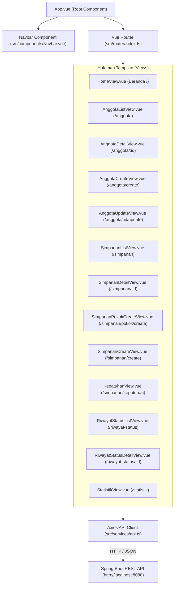

# SIKopDes - Modul KD1: Keanggotaan dan Simpanan (Front-End)

Aplikasi antarmuka pengguna (*Front-End*) untuk sistem **SIKopDes (Sistem Informasi Koperasi Desa Merah Biru)** - Modul **KD1: Keanggotaan dan Simpanan**, dibangun menggunakan **Vue 3**, **Vite**, **TypeScript**, **Bootstrap 5**, dan **Chart.js**.

- **Nama**: Raihan Maulana Heriandry
- **NPM**: 2406351024
- **Mata Kuliah**: Arsitektur Perangkat Lunak Terintegrasi (APAP) - Gasal 2026/2027

---

## 🎨 1. Arsitektur Front-End & Fitur Antarmuka

Aplikasi front-end dirancang dengan arsitektur berbasis komponen (*Single Page Application* / SPA) yang modular dan terstruktur rapi:



### 16 Fitur Antarmuka Utama yang Diimplementasikan:
1. **Beranda (`/`)**: Ringkasan jumlah anggota berdasarkan 5 status operasional, total setoran simpanan bulan berjalan, serta kartu interaktif yang terhubung langsung ke daftar anggota dengan filter status.
2. **Daftar Anggota (`/anggota`)**: Menampilkan seluruh anggota terurut ascending ID, dilengkapi live search (No. Anggota, Nama, NIK, Email), filter status, dan tombol Detail.
3. **Detail Anggota (`/anggota/{id}`)**: Profil lengkap, ringkasan saldo akumulasi (pokok, wajib, sukarela, total), riwayat simpanan descending, riwayat perubahan status, serta tombol aksi kontekstual dinamis sesuai status keanggotaan.
4. **Pendaftaran Anggota Baru (`/anggota/create`)**: Validasi NIK 16 digit, format email & telepon, status otomatis `MENUNGGU_VERIFIKASI`.
5. **Ubah Data Anggota (`/anggota/{id}/update`)**: Perubahan profil tanpa mengubah NIK & nomor anggota tetap.
6. **Verifikasi / Penolakan Anggota**: Verifikasi ke status `MENUNGGU_SETORAN_POKOK` atau penolakan dengan input alasan wajib ke status `DITOLAK`.
7. **Pengeluaran Anggota (Keluar)**: Dialog konfirmasi modal dan input alasan pengeluaran wajib untuk status `KELUAR` (soft delete bisnis).
8. **Daftar Simpanan (`/simpanan`)**: Riwayat setoran terurut descending tanggal setor, filter jenis (Pokok, Wajib, Sukarela), filter periode, dan filter rentang nominal numeric.
9. **Detail Simpanan (`/simpanan/{id}`)**: Informasi transaksi simpanan read-only dengan hyperlink ke profil anggota.
10. **Pencatatan Simpanan Pokok (`/simpanan/pokok/create`)**: Khusus anggota `MENUNGGU_SETORAN_POKOK`, nominal min. Rp100.000, aktivasi otomatis menjadi `AKTIF`.
11. **Pencatatan Simpanan Wajib & Sukarela (`/simpanan/create`)**: Simpanan wajib min. Rp20.000 dengan format periode `YYYY-MM` & pencegahan duplikasi; simpanan sukarela tanpa periode.
12. **Daftar Riwayat Status (`/riwayat-status`)**: Audit trail perubahan status terurut descending tanggal, filter statusBaru & rentang tanggal.
13. **Detail Riwayat Status (`/riwayat-status/{id}`)**: Rincian audit trail status, link profil anggota, dan informasi pemeriksaan sistem terkait bila diubah oleh `SISTEM`.
14. **Pembekuan & Pengaktifan Kembali**: Bekukan dengan alasan wajib; Aktifkan kembali dengan validasi otomatis pelunasan 3 periode simpanan wajib terakhir bagi anggota nonaktif.
15. **Halaman Kepatuhan Simpanan Wajib (`/simpanan/kepatuhan`)**: Evaluasi 3 periode selesai sebelum bulan acuan (Patuh, Menunggak, Belum Dievaluasi) serta ringkasan 5 eksekusi job otomatis terakhir.
16. **Statistika (`/statistik`)**: Filter tahun, mode bulanan/kuartalan, visualisasi Chart.js untuk distribusi status anggota dan tren simpanan 12 bulan.

---

## 📂 2. Struktur Repositori

```
sikopdes-2406351024-fe/
├── public/                                       # Aset publik statis (favicon, logo, icons)
├── src/
│   ├── __tests__/                                # Pengujian unit komponen & fungsionalitas
│   │   └── App.spec.ts                           # Unit test menggunakan Vitest
│   ├── components/                               # Komponen UI yang dapat digunakan kembali (reusable)
│   │   └── Navbar.vue                            # Bar navigasi utama aplikasi
│   ├── router/                                   # Konfigurasi perutean halaman (Vue Router)
│   │   └── index.ts                              # Definisi 13 route antarmuka
│   ├── services/                                 # Layanan integrasi komunikasi HTTP
│   │   └── api.ts                                # Axios instance & endpoint base URL
│   ├── stores/                                   # State management Pinia
│   │   └── counter.ts
│   ├── utils/                                    # Utilitas & formatting data
│   │   └── formatters.ts                         # Formatter mata uang Rupiah & tanggal lokal
│   ├── views/                                    # Halaman tampilan utama aplikasi (Views)
│   │   ├── anggota/
│   │   │   ├── AnggotaCreateView.vue             # Form pendaftaran anggota baru
│   │   │   ├── AnggotaDetailView.vue             # Profil detail, saldo simpanan, & aksi status
│   │   │   ├── AnggotaListView.vue               # Daftar anggota, live search & filter status
│   │   │   └── AnggotaUpdateView.vue             # Form edit biodata anggota
│   │   ├── riwayat/
│   │   │   ├── RiwayatStatusDetailView.vue       # Detail audit trail status anggota
│   │   │   └── RiwayatStatusListView.vue         # Audit trail riwayat status & filter tanggal
│   │   ├── simpanan/
│   │   │   ├── KepatuhanView.vue                 # Evaluasi kepatuhan 3 periode simpanan wajib
│   │   │   ├── SimpananCreateView.vue            # Pencatatan setoran simpanan wajib & sukarela
│   │   │   ├── SimpananDetailView.vue            # Informasi rincian transaksi simpanan
│   │   │   ├── SimpananListView.vue              # Daftar transaksi simpanan & filter nominal
│   │   │   └── SimpananPokokCreateView.vue       # Pencatatan setoran simpanan pokok pertama
│   │   ├── statistik/
│   │   │   └── StatistikView.vue                 # Grafik visualisasi tren & distribusi (Chart.js)
│   │   └── HomeView.vue                          # Beranda dashboard & statistik ringkasan
│   ├── App.vue                                   # Komponen utama root Vue SPA
│   ├── env.d.ts                                  # TypeScript ambient declarations
│   └── main.ts                                   # Bootstrap inisialisasi aplikasi Vue
├── .editorconfig
├── .eslintcache
├── .gitattributes
├── .gitignore                                    # Mengabaikan node_modules, dist, dsb.
├── .oxlintrc.json                                # Konfigurasi linter Oxlint
├── .prettierrc.json                              # Konfigurasi pemformatan kode Prettier
├── eslint.config.ts                              # Konfigurasi ESLint Flat Config
├── index.html                                    # Host file HTML utama Vite
├── package.json                                  # Daftar package, scripts, dan metadata proyek
├── package-lock.json                             # Kunci versi dependensi npm
├── tsconfig.app.json                             # Konfigurasi compiler TypeScript aplikasi
├── tsconfig.json                                 # Konfigurasi compiler TypeScript global
├── tsconfig.node.json
├── tsconfig.vitest.json
├── vite.config.ts                                # Konfigurasi build runner Vite
├── vitest.config.ts                              # Konfigurasi unit testing runner Vitest
└── README.md
```

---

## 🛠️ 3. Prasyarat & Instalasi

### Prasyarat Sistem:
- **Node.js**: versi 20.x atau 22.x LTS
- **npm**: versi 10.x atau lebih baru

### Langkah Menjalankan:
1. Masuk ke direktori front-end dan pasang dependensi:
   ```bash
   cd sikopdes-2406351024-fe
   npm install
   ```
2. Jalankan development server:
   ```bash
   npm run dev
   ```
3. Buka browser pada alamat:
   ```
   http://localhost:5173
   ```

---

## 🔍 4. Pemeriksaan Kualitas Kode (Linting & Testing)

Aplikasi telah lulus pemeriksaan kualitas kode dan pengujian:
```bash
# Type-check TypeScript & build production bundle
npm run build

# Menjalankan linter (ESLint & Oxlint)
npm run lint

# Menjalankan unit tests dengan Vitest
npx vitest run
```
Seluruh perintah di atas berjalan sukses tanpa error maupun warning.
